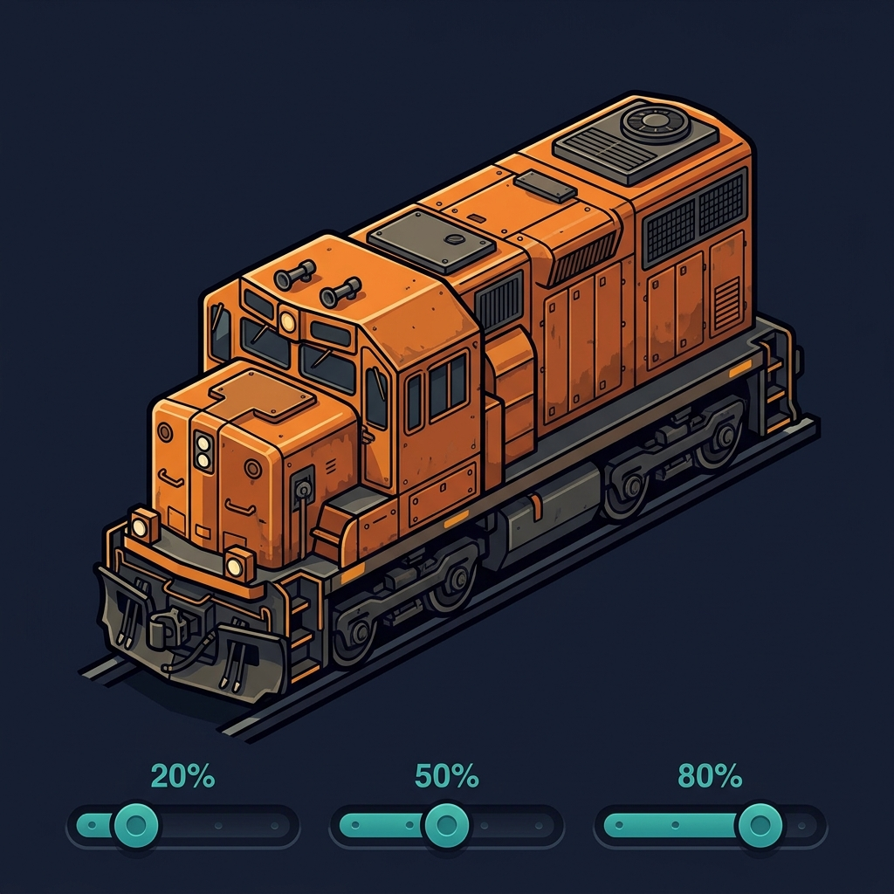

# Train Parameter Mod



A standalone C# mod for **Captain of Industry** with six adjustable train
parameters in a live in-game window. Parameter defaults are all 1.
Built against **0.8.7d / Update 4**. Experimental game APIs may change in later versions.

**Validation status:** build and 166 headless integration checks pass against the
installed game assemblies, including the menu constructor hook, native F8
registration, simulation-side application, saved-value round-trip, and the load
lifecycle with a capacity property missing until native post-load repair. The tests
now execute native movement and complete cargo transfers: loading and unloading
take 40 / 400 / 4000 ticks at 10x / 1x / 0.1x under sufficient supply and power.
The menu, capacity and curve settings have player confirmation; the revised
acceleration, cargo timing, shared braking factor and stepped-slider layout still
need confirmation in the running game.
The tests also exercise the game's actual config-attachment method when the mod
is first added to an existing save, and when that modded save is subsequently resumed.

Version **0.1.1** fixes loading older saves: runtime property access is deferred from
`EarlyInit` to `IMod.Initialize`, after the game's `InitAfterLoad` repair callbacks.
Failed initialization also preserves the original error and removes installed hooks.

Version **0.1.2** patches the final native movement result for acceleration and scales
the complete native cargo work cycle, including connection/disconnection and animations.
It replaces the previous helper/getter hooks and keeps cargo quantity per batch unchanged.

Version **0.1.3** applies the acceleration factor to native brake force too. The game's
braking-distance estimates and curve/station braking all read the scaled force.
The live menu uses native sliders with 0.1 steps, a value display, minus/plus buttons
and left/right arrow-key control.

Version **0.1.4** stretches sliders across the settings window. Cargo cycles draw
from compatible connected module buffers, removing the slow inter-module balancing
bottleneck. Two/four-module tests load and unload every wagon part equally per tick
at 0.1x, 1x and 10x, even with supply/free space concentrated at one end. Total
stock is conserved. Disabled modules, disabled balancing, different products,
loading modes and opposite station sides remain separate. External supply/output
rates, power, workers and native wagon restrictions still apply. Visual slider
layout and these station changes need confirmation in the running game.

| Setting | Range | Effect |
| --- | --- | --- |
| Curve slowdown factor | 0–5 | 1 = vanilla; 0 = no curve-specific speed cap; 0.5 = double the curve limit; 2 = half |
| Acceleration & braking multiplier | 0.1–10 | Scales positive speed gain under traction and native brake force; braking distances follow the same factor |
| Wagon capacity multiplier | 0.1–10 | Multiplies cargo capacity in addition to difficulty/research modifiers |
| Speed multiplier | 0.1–5 | Scales train top speed and rail limits; engine power can still limit actual speed |
| Loading speed multiplier | 0.1–10 | Scales the complete loading clock, connection, crane/transfer cycle and disconnect |
| Unloading speed multiplier | 0.1–10 | Scales the complete unloading clock, connection, crane/transfer cycle, disconnect and molten-wagon tilt |

All values default to **1**. Settings are stored by the game with the save.
Changes apply during the current session, including to existing trains and wagons.
Lowering capacity retains existing cargo; an over-capacity wagon can unload normally
and cannot accept more cargo until space becomes available.

Signals, station/depot maneuvering limits, supply availability and storage limits
remain in effect. Native braking-distance prediction uses the selected brake force.
Cargo is moved through the native transfer
methods, with normal per-batch quantities and capacity checks. A fractional clock
runs 0.1–10 logical cargo steps per simulation tick, retaining connection, animation,
power and departure checks. Conveyor/pipe throughput and train alignment movement
between different cars remain governed by the game.
The global engine speed ceiling still applies. Route estimates and train performance
charts may use cached vanilla data. Very large multipliers can stress game physics.

## Build with dotnet

On Windows, install the **.NET 10 SDK** and own an installed Steam copy of the game.
The mod targets **.NET Framework 4.8**; reference assemblies are restored via NuGet.
The headless test runner uses .NET 10, which supports the default interface methods
in the game's UI assemblies. It does not launch or control the game.
Visual Studio and Unity are not required.

```powershell
$env:COI_ROOT = 'C:\Program Files (x86)\Steam\steamapps\common\Captain of Industry'
dotnet build TrainParameterMod.sln -c Release
./scripts/Build.ps1
```

`Build.ps1` builds the solution, runs integration checks against your installed game
assemblies, and creates `dist/TrainParameterMod-0.1.4.zip`.
Pass `-GameRoot 'D:\SteamLibrary\steamapps\common\Captain of Industry'` for a custom install.

To build, check and install into your own mods directory:

```powershell
./scripts/Build.ps1 -Install
```

## Play

1. Extract the release ZIP into `%APPDATA%\Captain of Industry\Mods`.
   The resulting folder must be `Mods\TrainParameterMod`, containing `manifest.json`.
2. Start or restart the game. Select **Train Parameter Mod** when creating a game
   or adding mods to a save.
3. In a running game, press **F8**, or use **Escape → Train Parameter Mod (F8)**.
   Move the six sliders in **0.1 steps** (or use minus/plus and the slider's left/right
   arrow keys) and click **Apply**. Changes are submitted to the next
   simulation callback, including while paused; no save, exit or reload is required.
   Opening with F8 does not pause the simulation. Apply keeps the window open so
   you can adjust values repeatedly while observing your trains.
4. **Cancel / Close**, the window's close button or Escape discard edits made
   since your last Apply. Already applied changes remain active. **Restore defaults**
   prepares vanilla values, which are applied only after clicking **Apply**.
   Settings can also be chosen using the wrench next to the mod before starting.

After installing an updated mod DLL, restart the game once to load the new code.
Subsequent parameter changes use the live window.

Try a separate test save first. This mod does not add content or unlock DLC trains.
It modifies the trains available in your game. Removing it from a modded save is
deliberately not advertised as safe: use defaults of 1 to restore standard behavior.
Errors are logged to `%APPDATA%\Captain of Industry\Logs`.

### Adding to an existing save

The manifest permits adding this mod to a save that did not previously contain it.
Missing saved mod settings receive the schema defaults (all six are 1), or the
values you choose in the mod-selection screen. Existing train objects are reused;
applying a neutral capacity modifier preserves the game's existing bonuses.
After Apply and the next save/autosave, the game stores the mod settings with that
save. Reloading reapplies them once, without multiplying a previously applied bonus again.

## Implementation

The native `ModJsonConfig` provides save persistence and native input controls.
A native `WindowController` registers F8 with `IUnityInputMgr`. The pause menu has
an additional entry to open the same window. A separate draft is initialized from
an immutable settings snapshot. Apply queues a new snapshot; `ISimLoopEvents.UpdateBeforeCmdProc`
updates mod config and train values on the simulation thread, including while paused.
Input handlers do not mutate train/prototype state. Closing the menu removes no
previously applied changes, and unloading unregisters the shortcut and patches.
The implementation uses these game API points:

| Parameter | Game model / hook |
| --- | --- |
| Curve / rail limits | `EntityWithTrainTrackBaseProto.MaxSpeedTilesPerTick`, restricted to `TrainTrackProto`; `IsStraight` distinguishes curves |
| Acceleration | Positive powered speed gain in the result of `Train.updateTrainMovementPhysics` |
| Braking | `TrainStaticData.MaxBrakingForceKn`, scaled from a weakly held original per data object; cached stopping charts and each train's braking-distance estimate are refreshed |
| Capacity | An owned delta modifier on `IdsCore.PropertyIds.TrainsCapacityMultiplier`; updates `CargoWagonProto.Capacity` and `SubCarCapacity` |
| Top speed | `Train.updateCachedValues`, derived from `TrainStaticData.MaxForwardsSpeedCombined` / `MaxBackwardSpeedCombined`; manual target speed is capped consistently |
| Loading / unloading | Native cargo-step calls in `TrainStationModule.SimUpdateInternal`, selected by `IsForLoading`; animation speed in `updateAnimation` and molten-wagon readiness methods |

Harmony applies small runtime hooks. No game DLLs, original game assets, decompiled
game implementations, private project code, credentials or machine configuration
are included. Building requires your own game installation.

## Artwork and licenses

The original mod artwork was generated with Google's `gemini-3.1-flash-image`.
`assets/thumbnail.png` is the in-game mod thumbnail. The optional
`scripts/Generate-Art.ps1` regenerates the source artwork using `GEMINI_API_KEY`;
building and playing the mod make no network requests.

Original mod code is MIT licensed. Harmony is distributed under its own MIT license
(see `THIRD-PARTY-NOTICES.txt`). This project is an independent community mod;
Captain of Industry and its materials belong to MaFi Games. Their
[Modding Policy](https://coigame.com/Legal/Modding-Policy) governs use with the game,
including free distribution of mods.

Official references: [modding guide](https://coigame.com/Modding),
[configuration](https://coigame.com/Modding/Configuration),
[example project](https://github.com/MaFi-Games/Captain-of-industry-modding).
